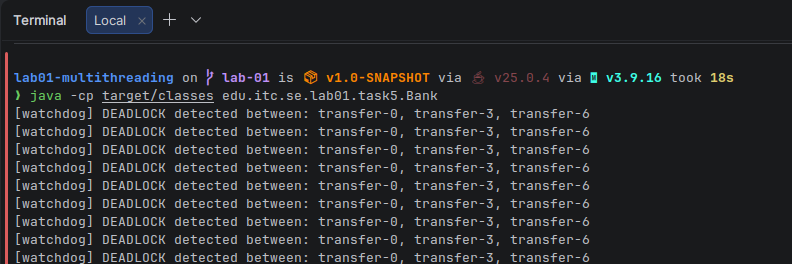

# Lab-01 · Multithreading in Java

Software Engineering · Chapter 01. JDK 25, Maven, JUnit 6.

This README holds the answers, timings and explanations for every task. The code is in
`src/main/java/edu/itc/se/lab01/` (one package per task) and the challenge test in
`src/test/java/edu/itc/se/lab01/challenge/WordCountTest.java`. The jstack output from Task 5 is in `deadlock.txt`.

## Build and test

```bash
mvn -q verify          # compiles everything and runs the JUnit tests (5 tests, all pass)
```

Each task has its own `main` class; the exact `java -cp target/classes ...` commands are in the "How to run" part of each section.

## Evidence

| What | File |
|---|---|
| jstack deadlock report (Task 5) | [`deadlock.txt`](deadlock.txt) |
| Watchdog detecting the deadlock at runtime (Task 5) | [`screenshots/task5-deadlock-watchdog.png`](screenshots/task5-deadlock-watchdog.png) |
| `[PARTIAL]` result by `--timeout 1` and by Ctrl+C (Challenge) | [`screenshots/challenge-partial.txt`](screenshots/challenge-partial.txt) |



## Contents

| Section | Main class | What the lab asks to explain (and where it is answered) |
|---|---|---|
| [Task 1](#task-1-creating-and-running-threads) | `task1.Main` | `run()` vs `start()` with the `--sequential` flag (section 4) |
| [Task 2](#task-2-fixing-a-race-condition) | `task2.Bench` | wrong totals of `UnsafeCounter`, timings, why `LongAdder` is faster, the `get()` visibility question (sections 4–6) |
| [Task 3](#task-3-producerconsumer-with-waitnotify-and-blockingqueue) | `task3.Main`, `task3.Main2` | why `while` + `notifyAll()` is required; what breaks with `notify()` + `if` (sections 4–5) |
| [Task 4](#task-4-thread-pools-future-and-virtual-threads) | `task4.Main` | platform pool vs virtual threads for I/O-bound work; failures, timeouts, shutdown |
| [Task 5](#task-5-diagnosing-a-deadlock-and-shutting-down-gracefully) | `task5.Bank`, `task5.Main` | jstack deadlock evidence, watchdog, lock ordering, `tryLock`, graceful interruption |
| [Challenge](#challenge-parallel-word-frequency-analyser) | `challenge.WordCount` | scaling table, `LongAdder`/`merge` vs `synchronized`, Coffman conditions (section 5) |

---

## Task 1: Creating and running threads

### 1. The big idea (read this first)

When you run a normal Java program, **one thread** (called `main`) executes your `main()` method, line by line. A *thread* is simply "one path of execution". If you start more threads, several paths run **at the same time**, each with its own current line of code.

In this exercise we start 4 countdowns. If they were ordinary method calls, each countdown would finish before the next one began (about 4 × 0.6 s). With threads, all four run together (about 0.6 s total).

### 2. What I did

| Step in the lab | Where it is |
|---|---|
| `Countdown extends Thread` | `Countdown.java` |
| `CountdownTask implements Runnable` | `CountdownTask.java` |
| Create 4 threads in 4 different ways, start, join, print states | `Main.java` |
| `--sequential` flag | `Main.java` (the `if (sequential)` branch) |

#### The four ways to make a thread

| Thread name | How it is made | In the code |
|---|---|---|
| apollo | **Subclass** `Thread` — the class *is* a thread | `new Countdown("apollo")` |
| gemini | **Runnable** — the class is only a *job*; you hand it to a `Thread` | `new Thread(new CountdownTask(), "gemini")` |
| mercury | **Lambda** — a Runnable written inline | `new Thread(() -> new CountdownTask().run(), "mercury")` |
| artemis | **Virtual thread** — a very cheap thread managed by the JVM, not the OS | `Thread.ofVirtual().name("artemis").unstarted(...)` |

Why `Runnable` is usually preferred over `extends Thread`: a Runnable is just "work to do". You can run it on a normal thread, a virtual thread, or a thread pool (exercise 4) without changing it. With `extends Thread` you are stuck with being a thread.

### 3. Workflow — who calls who

```
main thread                         new threads
-----------                         -----------
Main.main()
  create apollo, gemini, mercury, artemis      (nothing is running yet: state NEW)
  for each thread: t.start() ──────────────►  JVM creates the thread, which then calls t.run()
  print "all launched"      (main continues immediately, it does NOT wait)
  for each thread: t.join()   ◄ main waits here until that thread is finished
  print "all landed"
  print name / isVirtual / state
```

Step by step:

1. `Main.main` creates the 4 `Thread` objects. They exist but **have not started** (`state = NEW`).
2. `t.start()` tells the JVM: "create a real thread and let it call `run()`". `start()` returns **immediately**. The new thread begins running in parallel.
3. `main` prints `Mission control: all launched` straight away, while the countdowns are still going. That is why that line appears near the top of the output.
4. `t.join()` means "**wait until this thread is dead**". After the loop of 4 joins, we know all countdowns are over, so "all landed" is always printed last.
5. Each thread's `run()` loops 3 → 1, calling `Thread.sleep(200)` between lines so the other threads get to print in between. This is why the output lines are interleaved.
6. After `join()`, each thread has state `TERMINATED` (finished). Only artemis reports `virtual=true`.

How `Countdown` and `CountdownTask` differ in getting the name:

- `Countdown` **is** the thread, so it calls `getName()` on itself.
- `CountdownTask` is **not** a thread, so it asks "which thread is running me right now?" with `Thread.currentThread().getName()`.

### 4. `start()` vs `run()` — the `--sequential` flag (the explanation the lab asks for)

`t.start()` → creates a **new thread** that calls `run()`.  
`t.run()` → is **just a normal method call**. It runs on the *current* thread (here `main`). Nothing parallel happens.

Real output of `--sequential` (from my run):

```
apollo: 3
apollo: 2
apollo: 1
apollo: liftoff!
main: 3            <-- gemini's job, but the thread running it is "main"!
main: 2
main: 1
main: liftoff!
main: 3            <-- mercury's job, also on "main"
...
Mission control: all launched      <-- printed only AFTER every countdown
Mission control: all landed
apollo   virtual=false state=NEW   <-- never started, so still NEW
```

What this shows:

- Countdowns run **one after another** (no overlap), and "all launched" appears **after** them — because `main` was busy doing the countdowns itself.
- Names print as `main` for gemini/mercury/artemis, because `CountdownTask` uses `currentThread()`, and the current thread really is `main`. (apollo still prints `apollo` since it uses its own `getName()`.)
- The thread objects stay `NEW` (never started), and `join()` on a never-started thread returns immediately.

### 5. Real output (concurrent mode — order changes every run)

```
mercury: 3
apollo: 3
gemini: 3
Mission control: all launched      <-- appears BEFORE the countdowns finish
artemis: 3
...
gemini: liftoff!
mercury: liftoff!
apollo: liftoff!
artemis: liftoff!
Mission control: all landed        <-- after all four joined
apollo   virtual=false state=TERMINATED
gemini   virtual=false state=TERMINATED
mercury  virtual=false state=TERMINATED
artemis  virtual=true  state=TERMINATED
```

### 6. Important details that matter for grading

- **`catch (InterruptedException e) { Thread.currentThread().interrupt(); }`** — `Thread.sleep` can be interrupted. We never leave the catch empty (−5 points). We restore the "interrupted" flag so whoever asked us to stop can still see it, and then we end the thread.
- Threads are **named** (good code quality).
- We use `join()` to wait, not `Thread.sleep()` guessing (−10 if you rely on sleep for ordering).

### 7. How to run

From the `lab01-multithreading` folder (compile once, then run):

```bash
javac -d target/classes $(find src/main -name "*.java")
java -cp target/classes edu.itc.se.lab01.task1.Main
java -cp target/classes edu.itc.se.lab01.task1.Main --sequential
```

---

## Task 2: Fixing a race condition

### 1. The big idea

Eight threads share **one** counter and each adds 1, one million times. The answer must be 8 000 000. With a plain counter we get a **smaller** number. Why?

`count++` looks like one step, but the computer does **three**:

1. **read** `count` into a temporary spot
2. **add** 1
3. **write** the result back

If two threads interleave, an update is lost:

```
count = 0
Thread 1: read -> 0
Thread 2: read -> 0          (Thread 1 hasn't written yet!)
Thread 1: write 1
Thread 2: write 1   X        both wrote 1
count = 1, but we expected 2
```

This is a **race condition** (a "lost update"). The result depends on lucky/unlucky timing.

### 2. What I did

| Class | Role |
|---|---|
| `Counter` | interface: `increment()` and `get()`. Lets `Bench` test any implementation the same way. |
| `UnsafeCounter` | plain `long count; count++` — **broken on purpose** |
| `SynchronizedCounter` | fix 1: `synchronized` methods |
| `LockCounter` | fix 2: `ReentrantLock`, with `unlock()` in `finally` |
| `AtomicCounter` | fix 3: `AtomicLong.incrementAndGet()` |
| `LongAdderCounter` | bonus: `LongAdder` |
| `Bench` | the test harness: starts 8 threads, joins them, prints value / correct / time |

### 3. Workflow — how the pieces connect

```
Bench.main()
  └─ run("SynchronizedCounter", new SynchronizedCounter())
        ├─ start 8 threads (inc-0 ... inc-7)
        │     each thread:  for 1,000,000 times -> counter.increment()
        │                                              ▲
        │              the interface hides WHICH counter this is
        ├─ join all 8 threads  (wait until they have all finished)
        └─ print counter.get(), compare with 8,000,000, print elapsed ms
```

The key trick: `Bench.run` only knows the `Counter` **interface**. That is why one harness can test five completely different implementations. That is called *programming to an interface* (polymorphism): `counter.increment()` calls whichever class was passed in.

### 4. How each fix works

- **synchronized**: only one thread at a time may be inside a synchronized method of the same object. Others wait their turn. Correct, but waiting is slow.
- **ReentrantLock**: same idea, written by hand: `lock()`, do the work, `unlock()`. The `unlock()` **must** be in `finally`, otherwise if the code between throws an exception the lock is never released and every other thread waits forever (the classic bug).
- **AtomicLong**: uses a special CPU instruction (compare-and-set) that does read+add+write as **one indivisible step** without locking. Faster than locks.
- **LongAdder**: keeps several separate cells instead of one number. Each thread mostly updates its **own** cell, so threads rarely collide. `sum()` adds the cells together when you read. Fastest when many threads update the same counter. Trade-off: while threads are still running, `get()` might not be an exact snapshot.

### 5. Real results from my machine

```
UnsafeCounter #1       value=3,384,995  correct=false  36 ms
UnsafeCounter #2       value=4,531,892  correct=false  2 ms
UnsafeCounter #3       value=8,000,000  correct=true   1 ms   <-- got lucky
SynchronizedCounter    value=8,000,000  correct=true   330 ms
LockCounter            value=8,000,000  correct=true   209 ms
AtomicCounter          value=8,000,000  correct=true   180 ms
LongAdderCounter       value=8,000,000  correct=true   29 ms
```

Wrong totals recorded (the lab asks to record them): **3,384,995** and **4,531,892** instead of 8,000,000.

Honest note: the third unsafe run was correct. That is normal — the lab says the race is *intermittent*. The JIT compiler and the OS scheduler sometimes let threads effectively run one after another (note it took only 1 ms). A race that "sometimes works" is the most dangerous kind of bug: tests pass, production breaks. To see the wrong value again, just re-run.

Speed ranking: `LongAdder` (fastest) < `Atomic` < `Lock` ≈ `Synchronized`. Timings change per machine and per run; the order is what matters. The unsafe version is "fast" only because it is **wrong**.

### 6. Question the lab asks: *why does making only `increment()` synchronized but not `get()` still leave a bug?*

Two reasons:

1. **Visibility.** `synchronized` does two things: mutual exclusion **and** it makes writes visible to the next thread that takes the same lock. If `get()` does not take the lock, the Java Memory Model gives **no guarantee** that the reader sees the latest value. It may read a stale value from a CPU cache or register. There is no "happens-before" relationship between the writers and the reader.
2. **In our program it might still look fine**, because `join()` itself creates a happens-before edge: everything a thread did is visible to whoever successfully joins it. So `Bench` (which joins) would read the correct value anyway. But a reader that does **not** join (for example a monitoring thread printing the counter while workers run) can see stale or outdated numbers, and for a `long` on some JVMs even torn values. So the class is still buggy; it only hides the bug in this one usage.

Fix: make `get()` synchronized too (as I did), or use an `AtomicLong` / a `volatile` read.

### 7. How to run

From the `lab01-multithreading` folder (compile once, then run):

```bash
javac -d target/classes $(find src/main -name "*.java")
java -cp target/classes edu.itc.se.lab01.task2.Bench
```

---

## Task 3: Producer–consumer with wait()/notify() and BlockingQueue

### 1. The big idea

Imagine a restaurant:

- **Producers** = cooks who make orders.
- **Consumers** = waiters who deliver them.
- **Buffer** = the small counter between them. It holds at most **5** orders.

Rules the buffer must enforce:

- If the counter is **full**, a cook must **wait** (cannot put).
- If the counter is **empty**, a waiter must **wait** (cannot take).
- When something changes, the people waiting must be **woken up**.

Several threads read/write the same buffer, so the buffer must also be thread-safe (`synchronized`).

### 2. What I did

| File | Role |
|---|---|
| `Order` | `record Order(int id, String item, int qty)`. A record is a short way to write an immutable data class. Also has `poisonPill()` (id = −1). |
| `OrderQueue` | interface with `put(Order)` and `take()`. Producer/Consumer only know this interface. |
| `BoundedBuffer` | **my hand-written buffer**: `ArrayDeque` + `synchronized` + `wait()` in a `while` + `notifyAll()` |
| `BlockingOrderQueue` | adapter around Java's built-in `ArrayBlockingQueue` (same interface) |
| `Producer` | makes N orders, random 0–20 ms pause, calls `queue.put(...)` |
| `Consumer` | calls `queue.take()`, "processes" for 5–30 ms, counts in an `AtomicInteger`, stops at the poison pill |
| `Scenario` | builds 2 producers + 3 consumers around a given queue, runs it, returns a result (shared by `Main`, `Main2`, `Experiment`) |
| `Main` | runs the scenario with `BoundedBuffer(5)`, then repeats it 20 times |
| `Main2` | same scenario but with `BlockingOrderQueue(5)` — **same Producer/Consumer, unchanged** |
| `BrokenBuffer` + `Experiment` | the lab's experiment: `notify()` + `if` instead of `notifyAll()` + `while` |

### 3. Workflow — who calls who

```
Main.main()
  └─ Scenario.run(new BoundedBuffer(5), ...)
        ├─ start producer-1 (orders 1..50)   ──► Producer.run() ──► queue.put(order) ─┐
        ├─ start producer-2 (orders 51..100) ──► Producer.run() ──► queue.put(order) ─┤
        │                                                                             ▼
        │                                                              BoundedBuffer (capacity 5)
        │                                                                             │
        ├─ start consumer-1,2,3 ──► Consumer.run() ──► queue.take() ◄─────────────────┘
        │                                  └─ sleep 5–30 ms, processed.incrementAndGet()
        ├─ join both producers          (all 100 orders have now been put)
        ├─ put 3 poison pills           (one per consumer)
        ├─ join all consumers           (each one stops when it takes a pill)
        └─ return Result(processed = 100)
```

#### Why the interface matters

`Producer` and `Consumer` hold an `OrderQueue`, never a `BoundedBuffer`. So in `Main2` I hand them an `ArrayBlockingQueue` adapter instead, and **not one line** of Producer/Consumer changes. This is the lab's "pluggable" requirement.

#### Poison pill

How does a consumer know there is no more work? It cannot just stop when the buffer is empty (producers may be slow). So after the producers finish, `Scenario` puts one special order (`id = −1`) **per consumer**. A consumer that takes it knows "end of work" and returns. The lab allows `Main` to put the pills after joining the producers; that is the simpler option, and I used it.

### 4. The heart of it: `BoundedBuffer`

```java
public synchronized void put(Order order) throws InterruptedException {
    while (items.size() == capacity) {   // full -> wait
        wait();
    }
    items.addLast(order);
    notifyAll();                          // wake everyone who might be waiting
}

public synchronized Order take() throws InterruptedException {
    while (items.isEmpty()) {             // empty -> wait
        wait();
    }
    Order order = items.removeFirst();
    notifyAll();
    return order;
}
```

How to read it:

- **`synchronized`**: only one thread at a time runs inside `put`/`take` of this buffer. That protects the deque.
- **`wait()`**: "I cannot continue. Release the lock and put me to sleep until someone notifies." It releases the lock, so other threads can get in. Without that release, nobody could ever make room and everything would freeze.
- **`notifyAll()`**: wakes all sleeping threads. They compete to re-acquire the lock one at a time.
- **Capacity check**: after `addLast` I check `items.size() > capacity` and throw `IllegalStateException` if it ever happens (the lab asks for assertions). It never triggered.

#### Why `while` and not `if`?  And why `notifyAll()` and not `notify()`?

**`while`** — A woken thread does *not* run immediately. It must first re-acquire the lock, and in the gap another thread may have already used up the item or space. Example: two consumers sleep on an empty buffer. A producer adds **one** order and wakes both. Consumer A grabs it. When consumer B finally gets the lock the buffer is **empty again**. With `if`, B continues anyway and calls `removeFirst()` on an empty deque → crash. With `while`, B re-checks the condition, finds it still false, and goes back to sleep. (Spurious wakeups, where Java wakes a thread for no reason, are another reason.)

**`notifyAll()`** — Producers and consumers sleep on the **same** object. `notify()` wakes just **one** arbitrary thread. It might wake a thread of the wrong kind (e.g. a consumer's `notify` wakes another consumer when a producer was needed). That thread rechecks, sees nothing to do, and sleeps again, while the thread that really could continue was never woken → possible hang. `notifyAll()` wakes everyone; the right ones proceed and the rest go back to sleep because of the `while`.

### 5. The experiment (`BrokenBuffer` + `Experiment`)

`BrokenBuffer` is the same as `BoundedBuffer` but with `if` instead of `while` and `notify()` instead of `notifyAll()`. `Experiment` runs the full scenario 20 times (8 s timeout each, then it interrupts so nothing is stuck forever).

**What I actually observed (20 trials on my machine):**

- **No trial hung**, and the final count was 100 in all 20.
- **But in every one of the 20 trials a consumer thread crashed** with an uncaught exception:

```
Exception in thread "consumer-2" java.util.NoSuchElementException
    at java.util.ArrayDeque.removeFirst
    at BrokenBuffer.take(BrokenBuffer.java:27)
```

That is exactly the failure the lab predicted: a woken consumer assumed the buffer was non-empty (because of `if`), but another thread had already taken the item, so `removeFirst()` hit an empty deque. The total still reached 100 only by luck: the crashed consumer had not removed anything, so the other two consumers finished the job and used up the pills. In another design (e.g. if a consumer died after taking an order) we would lose work, or leave a consumer waiting forever.

So the honest summary: I **saw the crash every time**, and I did **not** see the hang in 20 trials. The hang (lost wake-up with `notify()`) is a real possibility that depends on timing; it is just rarer here. Both are the same root problem: a thread acting on a condition that is no longer true. `while` + `notifyAll()` removes it, and `BoundedBuffer` passed all 20 runs cleanly.

### 6. Real results

`Main` (hand-written `BoundedBuffer`):

```
Total processed: 100 (expected 100) in 696 ms
run  1 ok  processed=100  669 ms
...
run 20 ok  processed=100  983 ms
All 20 runs correct.
```

`Main2` (`ArrayBlockingQueue`, same Producer/Consumer):

```
consumer-2 received poison pill, stopping
consumer-1 processed Order[id=50, item=item-50, qty=3]
consumer-1 received poison pill, stopping
consumer-3 received poison pill, stopping
Total processed: 100 (expected 100) in 693 ms
```

Order of lines changes every run — that is normal for threads.

`BlockingQueue` vs by hand: `BlockingOrderQueue` is about 10 lines and has none of the `wait/notify/while` traps. `ArrayBlockingQueue.put/take` do the full/empty waiting for you. In real code, prefer it.

### 7. How to run

From the `lab01-multithreading` folder (compile once, then run):

```bash
javac -d target/classes $(find src/main -name "*.java")
java -cp target/classes edu.itc.se.lab01.task3.Main
java -cp target/classes edu.itc.se.lab01.task3.Main2
java -cp target/classes edu.itc.se.lab01.task3.Experiment
```

---

## Task 4: Thread pools, Future and virtual threads

### 1. The big idea

In exercise 1 we created each thread by hand. That is expensive and messy: a real program may have thousands of small jobs, and you do not want one new OS thread per job.

A **thread pool** (`ExecutorService`) is a "team of workers" that is created once. You give it **jobs**; free workers pick them up. You get back a **`Future`** = a receipt/ticket: "the result will be here later; call `get()` to collect it (waiting if needed)".

```
your code ── submit(job) ──► [ pool: queue of jobs ] ──► worker threads run them
     ▲                                                          │
     └──────────── future.get()  (the result, or the error) ◄───┘
```

Two kinds of work behave very differently:

- **CPU-bound** (maths): threads are busy computing. More threads than CPU cores does not help. → use a **fixed pool sized to the cores**.
- **I/O-bound** (waiting for network/disk): threads mostly **sleep**. → you want a huge number of cheap threads → **virtual threads**.

### 2. What I did

| File | Role |
|---|---|
| `PrimeCounter` | `Callable<Long>`: counts primes in `[from, to)` with naive trial division |
| `FakeDownload` | `Callable<String>`: sleeps 200 ms (fake network), returns `url -> length`. Every 50th throws `IOException("boom")`. One is slow (5 s). |
| `Main` | runs all parts: primes, downloads on 2 kinds of executors, failures, timeout, shutdown, `CompletableFuture` bonus |

`Runnable` vs `Callable`: a `Runnable.run()` returns nothing and cannot throw checked exceptions. A `Callable.call()` **returns a value** and **may throw**. That is why a `Future` can hand you either the result or the failure.

### 3. Workflow — part by part

#### Part 1: CPU-bound — counting primes

```
Main.primeDemo()
  1. single-threaded: PrimeCounter.countPrimes(0, 4_000_000)       -> 283146
  2. pool = newFixedThreadPool(availableProcessors())              (8 workers here)
     for i in 0..15:  submit(new PrimeCounter(i*LIMIT/16, (i+1)*LIMIT/16))   -> 16 Futures
     total = sum of future.get()                                    <- get() waits for each chunk
  3. compare: same total, less time
```

Why 16 chunks for 8 workers? Small chunks keep every worker busy (chunks near the top contain bigger numbers and take longer, so extra chunks let a free worker "steal" the next job instead of waiting).

Result: **283146 primes in both runs**, single 4371 ms vs pool 1144 ms (about 3.8× faster on my machine). The pool is faster because chunks run on different CPU cores at the same time. It is not 8× because chunk sizes are uneven and the machine has other load.

#### Part 2: I/O-bound — 500 downloads

```
Main.downloadDemo(label, executor)
  try (executor) {                                 <- try-with-resources: closes (waits for tasks) at the end
     for each of the 500 FakeDownload: futures.add(executor.submit(d))
     summary = collect(futures)
  }
  print ok / failed / timedOut / elapsed
```

Run twice with different executors:

| Executor | Real time | Why |
|---|---|---|
| fixed pool of **20 platform threads** | **5287 ms** | 500 jobs × 200 ms ÷ 20 threads ≈ **5 s**. Only 20 can sleep at once; the other 480 wait in the queue. |
| **virtual threads** (`newVirtualThreadPerTaskExecutor`) | **1028 ms** | 500 virtual threads all sleep **at the same time** ≈ 200 ms (plus the 1 s timeout we wait on the slow task). |

**The explanation:** a sleeping/waiting platform thread still occupies a whole OS thread (about 1 MB of stack, an OS scheduler entry), so you can only have so many. A **virtual thread** is a lightweight thread managed by the JVM. When it blocks (sleep, network), the JVM parks it and reuses the underlying OS thread for another virtual thread. So waiting is almost free and you can have thousands. That is why they are several times faster for I/O-bound work. They give **no benefit for CPU-bound** work (that is why Part 1 uses a platform pool).

#### Part 3: failures — `ExecutionException`

Every 50th download (ids 50, 100, …, 500) throws `IOException("boom")` → 10 failures.

When a task throws, the exception is **not** thrown at `submit`. The pool catches it and stores it in the `Future`. Later `future.get()` throws **`ExecutionException`**, and `e.getCause()` is the original `IOException`. In `collect` I catch it, count `failed++`, and continue. The program never crashes with a stack trace. Output: `example failure cause: java.io.IOException: boom`.

#### Part 4: timeouts

Download #1 sleeps 5 s. For it, `collect` uses `f.get(1, TimeUnit.SECONDS)`:

- if it is not ready after 1 s → `TimeoutException` is thrown,
- I call `f.cancel(true)` (`true` = interrupt the worker thread, so `Thread.sleep` throws `InterruptedException` and the task stops instead of wasting the thread for 5 s),
- and count `timedOut++`.

I wait on this slow task **first**, so the 1-second timeout is really measured (the hint in the lab). If it was last, `get()` would return immediately because it would have already been cancelled or done.

Final summary on both executors: **`ok=489 failed=10 timedOut=1`** (489 + 10 + 1 = 500).

#### Part 5: shutdown

Both parts use **try-with-resources** (`try (ExecutorService pool = ...)`). Since JDK 19 an `ExecutorService` is `AutoCloseable`: leaving the block calls `close()`, which stops accepting jobs and waits until running ones finish. If you forget to shut down a pool, its worker threads (non-daemon) keep the JVM alive forever (−10 points in the rubric). My program ends by itself without `System.exit` — it printed the last line and the process exited.

#### Bonus: `CompletableFuture`

```java
CompletableFuture.supplyAsync(() -> run(d), executor)        // start the job asynchronously
                 .handle((value, error) -> error == null ? value : "fallback for " + d.url());
...
CompletableFuture.allOf(all...).join();                      // wait until every one has finished
```

- `supplyAsync` = like `submit`, but you chain steps instead of blocking on `get()`.
- `handle` receives **either** the value or the error and returns a replacement, so a failure becomes a harmless fallback string and no exception escapes.
- `allOf(...)` completes when all are done.

Result: `normal=490 fallback=10 in 232 ms` (no slow task in this part, so it is quick).

### 4. Real output

```
single-threaded: 283146 primes in 4371 ms
pool (8 threads): 283146 primes in 1144 ms  (same as single: true)

downloads on fixed(20) platform threads  : ok=489 failed=10 timedOut=1 in 5287 ms
    example failure cause: java.io.IOException: boom
downloads on virtual threads             : ok=489 failed=10 timedOut=1 in 1028 ms
    example failure cause: java.io.IOException: boom

CompletableFuture on virtual threads: normal=490 fallback=10 in 232 ms
main finished, JVM will exit by itself
```

(Times depend on your machine.)

### 5. How to run

From the `lab01-multithreading` folder:

```bash
javac -d target/classes $(find src/main -name "*.java")
java -cp target/classes edu.itc.se.lab01.task4.Main
```

---

## Task 5: Diagnosing a deadlock and shutting down gracefully

### 1. The big idea

A **deadlock** = threads wait for each other forever, so nobody ever continues. Classic story:

```
Thread A: owns lock X, wants lock Y
Thread B: owns lock Y, wants lock X
          -> A waits for B, B waits for A. Forever.
```

In our bank, `transfer(from, to)` locks `from` first, then `to`:

```
transfer-0:  transfer(acc1 -> acc2)  locks acc1, then waits for acc2
transfer-6:  transfer(acc2 -> acc1)  locks acc2, then waits for acc1   => DEADLOCK
```

The lock order depends on the **argument order**, so two threads can lock in opposite orders. This is exactly the **circular wait**, one of the four Coffman conditions for deadlock (the others: mutual exclusion, hold-and-wait, no preemption). Remove any one of them and deadlock is impossible. Fix A removes circular wait; Fix B removes hold-and-wait.

### 2. What I did

| File | Role |
|---|---|
| `Bank` | the **deliberately broken** bank from the lab. `main` here hangs. It also starts the watchdog. |
| `Watchdog` | daemon thread: every second asks the JVM `findDeadlockedThreads()` and prints their names |
| `TransferService` | small interface (`transfer`, `total`, `retries`) so both fixes share the same test code |
| `OrderedBank` | **Fix A**: always lock the lower account id first |
| `TryLockBank` | **Fix B**: `ReentrantLock` + `tryLock(10 ms)` + release and retry with random back-off |
| `Runner` | test harness: `runFixed` (8 threads × 100 000 transfers) and `runUntilInterrupted` (graceful shutdown) |
| `Main` | runs Fix A, Fix B, then the graceful shutdown for both |
| `deadlock.txt` (project root) | real `jstack` output from my machine, as the lab requires |

### 3. Step 1–3: reproduce, diagnose, detect

**Run the broken bank:**

```bash
java -cp target/classes edu.itc.se.lab01.task5.Bank
```

It hangs within a second (never prints `total = ...`). Press Ctrl+C to stop it.

**Watchdog output (real):**

```
[watchdog] DEADLOCK detected between: transfer-0, transfer-6
[watchdog] DEADLOCK detected between: transfer-0, transfer-6   (repeats every second)
```

How the watchdog works: `ManagementFactory.getThreadMXBean().findDeadlockedThreads()` returns the ids of threads stuck in a cycle (or `null` if none). I turn the ids into names with `getThreadInfo(ids)`. It is a **daemon** thread so it never keeps the JVM alive.

**jstack (the real evidence, saved in `deadlock.txt`):** while the program hung, I ran `jstack <pid>` (the JDK tool; `jcmd <pid> Thread.print` does the same). The key part:

```
Found one Java-level deadlock:
"transfer-0":
  waiting to lock monitor ... (a edu.itc.se.lab01.task5.Bank$Account),
  which is held by "transfer-6"
"transfer-6":
  waiting to lock monitor ... (a edu.itc.se.lab01.task5.Bank$Account),
  which is held by "transfer-0"
```

How to read it: transfer-0 is waiting for a lock that transfer-6 holds, and transfer-6 is waiting for a lock that transfer-0 holds. The stack shows both inside `Bank.transfer(Bank.java:32)`, the inner `synchronized (to)`. Lines "- locked <…>" show what each thread already holds; "- waiting to lock <…>" shows what it wants. The addresses swap, which proves the cycle.

### 4. Fix A — lock ordering (`OrderedBank`)

```java
Account first  = from.id < to.id ? from : to;
Account second = from.id < to.id ? to : from;
synchronized (first) {
    synchronized (second) {
        ...move money...
    }
}
```

Every thread now locks accounts in **ascending id order**, no matter which direction the money goes. A cycle needs somebody to lock in descending order, which never happens → **no circular wait → no deadlock**.

Result: `transfers=800000 retries=0 total=4000 (expected 4000) in 109 ms`: every transfer completed, the total is unchanged, nothing hung.

### 5. Fix B — `tryLock` with back-off (`TryLockBank`)

```java
while (true) {
    if (from.lock.tryLock(10, ms)) {
        try {
            if (to.lock.tryLock(10, ms)) {
                try { ...move money...; return; }
                finally { to.lock.unlock(); }
            }
        } finally { from.lock.unlock(); }       // release the FIRST lock before backing off
    }
    retries.increment();
    Thread.sleep(random 1..4 ms);               // random back-off
}
```

- `tryLock(10 ms)` = "try to get the lock, but give up after 10 ms" instead of waiting forever.
- If we cannot get the **second** lock we **release the first** and sleep a random time. This is the important part: if we kept the first lock while backing off we would re-create *hold and wait* (the lab hint). The random back-off makes it unlikely that two threads retry in perfect step.
- Every unlock is in a `finally`, so the lock is always released, even on an exception or interrupt.

Result: `transfers=800000 retries=12481 total=4000 (expected 4000) in 31935 ms`: every transfer completed and the retries are counted (the number changes each run).

**Honest notes about Fix B:**

1. **It is much slower than the lab's example (910 ms).** On my machine it took about 20–38 s (it varied between runs). `OrderedBank` takes under 0.2 s. A contended `ReentrantLock` parks and unparks threads (expensive), while 8 threads fight over only 4 accounts. The result is still correct, only slow. Lock ordering is the better fix when you can use it; `tryLock` is useful when you cannot know the order in advance.
2. **The watchdog gives false alarms for `TryLockBank`.** When I left the watchdog running during Fix B, it printed `DEADLOCK detected between transfer-…` many times. `findDeadlockedThreads()` also looks at `ReentrantLock` ownership, and it sees threads waiting on each other in a cycle. But those cycles are **temporary**: the 10 ms timeout breaks them and the program finishes with the correct total. So a watchdog report only means "a cycle exists right now", and with timed locks that cycle can resolve itself. (I removed the watchdog from `Main` so the output stays clean; it is only used with the broken `Bank`.)

### 6. Step 6 — graceful shutdown (interruption)

You cannot (and must not) kill a thread with `Thread.stop()` (−5 points; it can leave data half-updated). Instead Java uses **cooperative cancellation**: you call `thread.interrupt()` which sets an "interrupted" flag; the thread must notice and stop itself.

Worker loop in `Runner.runUntilInterrupted`:

```java
try {
    while (!Thread.currentThread().isInterrupted()) {    // check the flag between transfers
        ... bank.transfer(...); done[index]++;
    }
} catch (InterruptedException e) {                       // thrown by blocking calls (tryLock, sleep)
    Thread.currentThread().interrupt();                  // restore the flag, then end
}
```

Two ways a worker notices the interrupt:

- **Pure CPU work** (`OrderedBank`): no blocking call ever throws, so only the `while (!isInterrupted())` check stops it.
- **Blocking calls** (`TryLockBank`: `tryLock`, `sleep`): they throw `InterruptedException` immediately. We catch it and **restore the flag** (`interrupt()` again), because catching the exception clears the flag; restoring it lets any code above see that we were asked to stop.

`main` then: sleeps 2 s → `interrupt()` all workers → `join(1000)` each (wait at most 1 s) → prints `isAlive()` for each, the number of transfers, and the final total.

Real output:

```
# OrderedBank (pure CPU work, stops by checking the flag)
[main] interrupting 8 workers after 2000 ms
  transfer-0 stopped after 2,437,644 transfers (alive=false)
  ...
  all workers stopped=true within 3 ms, transfers=18,146,881, total=4000 (expected 4000)
# TryLockBank (can also be interrupted inside tryLock/sleep)
[main] interrupting 8 workers after 2000 ms
  all workers stopped=true within 2 ms, transfers=9,241, total=4000 (expected 4000)
```

All workers stopped within a few milliseconds (far under the 1 s limit) and the **invariant still holds** (total = 4000): an interrupt only takes effect *between* transfers (or while waiting for a lock, in which case no money has moved yet), so no transfer is ever half done. The lock is released in `finally` even when the interrupt hits while we hold it.

### 7. How to run

From the `lab01-multithreading` folder:

```bash
javac -d target/classes $(find src/main -name "*.java")
java -cp target/classes edu.itc.se.lab01.task5.Main      # Fix A, Fix B, graceful shutdown (about 30–60 s because Fix B is slow)
java -cp target/classes edu.itc.se.lab01.task5.Bank      # the broken one: hangs, press Ctrl+C
```

To take your own jstack while `Bank` hangs, open a second terminal, run `jps` to get the pid, then `jstack <pid>`.

---

## Challenge: Parallel word-frequency analyser

### 1. The big idea (read this first)

We want to count how often each word appears in **200 text files** (10 million words) as fast as possible, using only the JDK. This challenge puts together everything from tasks 1–5:

| Idea from... | Used here as |
|---|---|
| Task 3 (producer–consumer) | one **scanner** produces file paths, **N workers** consume them, through a **bounded `BlockingQueue`** |
| Task 2 (race conditions) | the shared word counts live in a `ConcurrentHashMap<String, LongAdder>`, so there are no lost updates and no big lock |
| Task 4 (executors) | workers run in an `ExecutorService` (platform pool **or** virtual threads); the progress reporter is a `ScheduledExecutorService` |
| Task 5 (interruption) | Ctrl+C and the `--timeout` deadline **interrupt** everyone, then we print a `[PARTIAL]` result |

```
 scanner thread                 queue (capacity 16)              workers (pool)
 Files.walk(dir) ──put(path)──► [ p p p p ... ] ──take()──► worker-1 ┐
   (blocks when full =                                        worker-2 ├─► counts: ConcurrentHashMap<String, LongAdder>
    back-pressure)                                            worker-N ┘        (lock-free increments)
   at the end: 1 POISON per worker                                │
                                                                  └─ latch.countDown() when a worker stops

 reporter (every 500 ms): files done / total, words, words/s, top 3   ← only reads, never locks the map
 main: latch.await(timeout)  ── true  → DONE result
                             └─ false → shutdown() → [PARTIAL] result
 Ctrl+C → shutdown hook ───────────────→ shutdown() (same method, runs only once)
```

### 2. What I did

All code is in `src/main/java/edu/itc/se/lab01/challenge/` and the test in `src/test/java/edu/itc/se/lab01/challenge/`.

| File | Role |
|---|---|
| `WordCount` | the tool: argument parsing, scanner, workers, reporter, shutdown, result + `result.csv` |
| `ReferenceWordCount` | single-threaded reference: a plain loop and a plain `HashMap`, no threads at all |
| `GenerateData` | test-data helper: writes 200 files × 50 000 words from a fixed 2 000-word vocabulary |
| `WordCountTest` | JUnit 6 tests: parallel result == reference result, CSV is correct, `--timeout 1` stops in < 3 s |

Other changes in the project:

- `pom.xml`: Java release **25** (as the lab asks), **JUnit Jupiter 6.1.3** (test scope) and `maven-surefire-plugin` 3.5.2 so `mvn verify` runs the tests.
- `.gitignore`: ignores `data/` (54 MB of generated text) and `result.csv`.
- The old placeholder `challenge/Main.java` ("Hello from Challenge!") was removed; `WordCount` is the main class now.

Command line:

```
WordCount <dir> [--top N] [--timeout SECONDS] [--virtual] [--workers N] [--csv FILE]
```

`--workers` (default = number of cores) and `--csv` (default `result.csv`) are extras I added: `--workers` is needed for the scaling table, `--csv` lets the tests write into a temp folder.

### 3. Workflow — who does what

#### 3.1 `run()` (main thread)

```
run()
  1. count the files once (Files.walk)               -> totalFiles, for "files 37/200"
  2. pool = fixed pool of N platform threads, or a virtual-thread-per-task executor
     submit N times:  try { work(); } finally { latch.countDown(); }
  3. start the "scanner" thread          -> scan()
  4. start the reporter every 500 ms     -> report()
  5. addShutdownHook(thread that calls shutdown())     <- Ctrl+C
  6. finished = latch.await(timeout)
       true  (all N workers stopped) -> stop reporter, join scanner, close pool, printResult(false)
       false (deadline passed)       -> print "deadline reached – stopping", shutdown()
  7. removeShutdownHook(...)  so a normal exit does not run it
```

**Why a `CountDownLatch`?** It starts at N. Each worker counts it down once when it stops. `await(timeout)` returns `true` when it reaches 0, or `false` when the deadline passes first. That `false` **is** our timeout signal — no `Thread.sleep` for timing (sleep-based ordering costs −10 points).

#### 3.2 `scan()` (scanner thread) — the producer

```java
for (Path p : files) queue.put(p);          // blocks when 16 paths are already waiting
for (int i = 0; i < workers; i++) queue.put(POISON);   // one "stop" pill per worker
```

- **Back-pressure:** the queue holds at most 16 paths. If the workers are slow, `put()` blocks and the scanner waits. So memory stays small even with 5 000 or 1 000 000 files.
- **Poison pill:** a special `Path` object `POISON`. A worker that takes it stops. One pill per worker, so every worker gets exactly one.
- If the scanner is interrupted while blocked in `put()`, it catches `InterruptedException`, **restores the flag** (`Thread.currentThread().interrupt()`) and returns. It does not put pills then, because the workers are being interrupted too.

#### 3.3 `work()` + `countFile()` (worker threads) — the consumers

```java
while (!Thread.currentThread().isInterrupted()) {   // checked between files
    Path p = queue.take();
    if (p == POISON) return;
    countFile(p);
    filesDone.incrementAndGet();
}
// catch (InterruptedException e) { Thread.currentThread().interrupt(); }
```

`countFile` reads the file line by line with `Files.lines(p)` (inside try-with-resources so the file is closed), splits each line with the **precompiled** pattern `[^\p{L}]+` (= "one or more characters that are not letters"), lower-cases each word and does:

```java
counts.computeIfAbsent(word, k -> new LongAdder()).increment();
```

- `computeIfAbsent` creates the `LongAdder` for a new word atomically (two workers seeing a new word at the same time still get the **same** adder).
- `increment()` on a `LongAdder` is lock-free (see section 5).
- `Pattern.compile` is done **once** as a `static final` field. Compiling it again for every line would be a hot spot.
- `split` gives an empty first string when a line starts with punctuation, so empty words are skipped.

**Interrupt while reading a file:** file channels are interruptible. If the worker is interrupted in the middle of a read, Java closes the channel and throws `ClosedByInterruptException`; the interrupt flag stays set, so the loop stops right after. That file is then **not** counted in `filesDone` (it was only partly read).

#### 3.4 `report()` (reporter thread)

Every 500 ms:

```
[1.6s] files 18/200 words 1,165,992 729,434 w/s   top: the(142,669) and(71,230) of(47,556)
```

- `filesDone` is an `AtomicInteger`, `wordsDone` is a `LongAdder` → reading them never blocks anyone.
- The top 3 comes from streaming `counts.entrySet()`. The iterator of a `ConcurrentHashMap` is **weakly consistent**: it never throws `ConcurrentModificationException` and never locks the map, but the numbers can be a few increments behind. That is fine for a progress line.

#### 3.5 `shutdown()` — one method for Ctrl+C **and** timeout

```java
void shutdown() {
    if (!stopping.compareAndSet(false, true)) return;   // only the first caller continues
    reporter.shutdownNow();
    scanner.interrupt();
    pool.shutdownNow();                                   // interrupts every worker
    pool.awaitTermination(≤ 2 s); scanner.join(rest of the 2 s);
    printResult(true);                                    // "[PARTIAL] ..."
}
```

- `AtomicBoolean.compareAndSet(false, true)` is true for **exactly one** caller. So if the deadline and Ctrl+C happen at the same time, the result is still printed once.
- `shutdownNow()` interrupts the pool's threads; the workers see the flag between files (or get `InterruptedException` from `take()`), restore it, and return.
- We wait **at most 2 s** in total, then print anyway.
- The **shutdown hook** runs while the JVM is exiting: so no `System.exit` inside it, and it finishes quickly.
- After a normal run, `run()` removes the hook with `removeShutdownHook`, otherwise it would fire when the program ends. During Ctrl+C a hook cannot be removed (`IllegalStateException`), which is caught — the hook is already doing the work.

#### 3.6 `printResult()`

Takes a snapshot of the map, sorts by count (descending, then word A→Z so ties are stable), prints the top N with count and share %, then the summary line, and writes **every** word to `result.csv`:

```
rank,word,count,share
1,the,1221781,12.2178
2,and,610731,6.1073
```

### 4. Verification (JUnit 6)

`mvn verify` → **`Tests run: 5, Failures: 0, Errors: 0`**

| Test | What it proves |
|---|---|
| `parallelPlatformMatchesReference` | 20-file fixture, 4 platform workers: the map is **identical** to `ReferenceWordCount` and 20 files are done |
| `virtualThreadsMatchReference` | same with 8 virtual-thread workers |
| `singleWorkerMatchesReference` | same with 1 worker (the poison-pill logic works with N = 1 too) |
| `csvIsWritten` | header line, `the` is rank 1, one row per distinct word |
| `stopsWithinThreeSecondsOnTimeout` | 5 000 files, `--timeout 1`: `run()` returns in **< 3 s**, the result is `[PARTIAL]`, and no `scanner` / `worker-*` / `reporter` thread is still alive |

Comparing the whole `Map<String, Long>` with `assertEquals` catches lost updates (a race would give smaller counts) **and** tokenising mistakes (the reference is written separately with its own loop and `HashMap.merge`).

### 5. Report (the 3 things the lab asks for in README.md)

#### 5.1 Scaling table

200 files × 50 000 words = 10 000 000 words, 2 000 distinct words. Each number is the **median of 3 runs** (each run is a fresh JVM, so JIT warm-up is included).
Machine: Intel Core i5-8250U — **4 physical cores / 8 hardware threads**, laptop (it throttles, so runs vary ±30 %).

| Workers | Elapsed (median) | 3 runs | Speed-up vs 1 |
|---|---|---|---|
| reference (single-threaded, no pipeline) | ≈ 6.3 – 11.2 s | — | — |
| 1 platform | **9.84 s** | 9.84 / 9.04 / 13.99 | 1.0× |
| 2 platform | **5.80 s** | 5.61 / 5.80 / 8.88 | 1.7× |
| 4 platform | **4.84 s** | 4.39 / 4.84 / 5.85 | 2.0× |
| 8 platform | **4.55 s** | 3.57 / 4.55 / 5.75 | 2.2× |
| 8 virtual (`--virtual`) | **4.68 s** | 4.19 / 8.89 / 4.68 | 2.1× |

What the table shows:

- **1 → 2 workers almost doubles the speed**; after that the gain gets small. The CPU has only 4 real cores; the 8 "threads" are hyper-threads that share those cores, so 8 workers cannot be 8× faster.
- **Fixed costs do not shrink** with more workers (Amdahl's law): JVM start, JIT warm-up (the first 1–2 s run slow interpreted code), counting the files, and one scanner thread. With only ~5 s of total work these fixed costs are a big part.
- Hot words: `the` is 12 % of all words, so every worker keeps hitting the same few `LongAdder`s. `LongAdder` handles this well, but it is still shared memory traffic between cores.
- **Virtual threads ≈ 8 platform threads.** This job is **CPU-bound** (splitting strings, hashing), not waiting for I/O — the files are in the OS page cache. Virtual threads run on a carrier pool with one carrier per core, so they cannot give more CPU than 8 platform threads. They shine when threads **wait** (task 4: 500 fake downloads), not when they compute.

Your numbers will be different on your machine; re-run with the commands in section 7 and update the table.

#### 5.2 Why `LongAdder` / `merge` beats `synchronized` on the map

With `synchronized (map) { map.put(w, map.getOrDefault(w, 0L) + 1); }` there is **one lock for the whole map**. Every word of every worker has to take that lock, one thread at a time. 8 workers then behave like 1 worker plus the cost of fighting for the lock (threads blocking, waking up, cache lines moving between cores). Adding workers can even make it **slower**.

`ConcurrentHashMap.merge(word, 1L, Long::sum)` is already much better: it only locks **one bin** (one bucket of the hash table) for a moment, so two workers updating different words do not block each other. But it still locks that bin for every update, and it creates a new `Long` object each time. Hot words like `the` live in one bin, so all workers still queue up on that bin.

`computeIfAbsent(word, k -> new LongAdder()).increment()` is the best of the three:

1. `computeIfAbsent` for a word that **already exists** is usually just a lock-free read: when the word is the first entry in its bin (most words), it returns the adder without locking. Otherwise it holds the bin lock only for a quick lookup — never for the counting itself. Inserting a new word happens only 2 000 times out of 10 000 000.
2. `LongAdder.increment()` uses **CAS** (compare-and-set, no lock). When many threads hit the same adder, it spreads them over several internal **cells** (roughly one per contending thread), so they stop retrying on the same memory word. `sum()` adds up the cells when someone reads.
3. No new objects per word (the `Long` boxing of `merge` is gone).

Trade-off: `LongAdder.sum()` is not an atomic snapshot while writers are still running — it is exact once the workers have stopped, and "close enough" for the progress line, which is exactly how we use it.

#### 5.3 Coffman conditions — why this design cannot deadlock

A deadlock needs **all four** Coffman conditions at the same time: (1) **mutual exclusion**, (2) **hold-and-wait**, (3) **no preemption**, (4) **circular wait**. Our design still has some mutual exclusion — the queue's internal lock and, briefly, a `ConcurrentHashMap` bin lock when a new word is inserted — but it rules out **hold-and-wait**, and with it **circular wait**: no thread ever holds one lock while waiting for another. The queue's lock is released while a thread waits in `put()`/`take()` (they wait on a `Condition`, which gives the lock back), the `computeIfAbsent` mapping function `k -> new LongAdder()` never touches another lock or the map itself, and `LongAdder` uses no lock at all. With at most one lock held at a time and never while blocking, a cycle "A waits for B, B waits for A" (task 5's bank) cannot form. On top of that, every blocking wait (`take`, `put`, `latch.await`, `awaitTermination`) is **interruptible**, which gives us a form of **preemption**: `shutdown()` can always pull a thread out of a wait, so even a bug that made a thread wait forever would end within the 2-second shutdown limit.

### 6. Real output (my machine)

Full run:

```
$ java -cp target/classes edu.itc.se.lab01.challenge.WordCount ./data --top 5 --timeout 30
[0.9s] files 0/200 words 10,632 12,441 w/s   top: the(1,962) and(1,046) of(774)
[1.5s] files 0/200 words 138,840 93,821 w/s   top: the(17,074) and(8,656) of(5,771)
...
[7.3s] files 102/200 words 5,319,612 724,713 w/s   top: the(650,722) and(324,562) of(216,479)
[7.8s] files 147/200 words 7,567,476 965,130 w/s   top: the(925,626) and(462,050) of(308,401)
DONE files=200 words=10,000,000 elapsed=8.35s mode=platform(8)
 rank word              count    share
    1 the           1,221,781   12.22 %
    2 and             610,731    6.11 %
    3 of              407,855    4.08 %
    4 to              305,400    3.05 %
    5 a               244,387    2.44 %
result.csv written
```

(The first second shows almost no progress: that is the JIT compiling the hot code. Once compiled, throughput climbs fast.)

Deadline:

```
$ java -cp target/classes edu.itc.se.lab01.challenge.WordCount ./data --top 3 --timeout 1
[0.6s] files 0/200 words 124,380 208,498 w/s   top: the(18,505) and(9,751) of(6,614)
[1.1s] files 3/200 words 360,372 329,883 w/s   top: the(44,246) and(21,988) of(14,534)
[1.2s] deadline reached – stopping
[PARTIAL] files=3 words=406,920 elapsed=1.21s mode=platform(8)
 rank word              count    share
    1 the              49,944   12.27 %
    2 and              24,720    6.07 %
    3 of               16,252    3.99 %
result.csv written
```

Ctrl+C (sent automatically after 2 s with `timeout -s INT 2 ...`; whole process ended after 2.3 s):

```
[0.6s] files ...   (progress lines)
[1.9s] Ctrl+C – stopping
[PARTIAL] files=13 words=795,896 elapsed=1.95s mode=platform(8)
 rank word              count    share
 ...
result.csv written
```

Note: in a `[PARTIAL]` result the word counts can include part of a file that was being read when the interrupt came; `files=` only counts files that were read completely.

### 7. How to run

From the `lab01-multithreading` folder:

```bash
mvn -q verify                                                          # compile + run the 5 JUnit tests

java -cp target/classes edu.itc.se.lab01.challenge.GenerateData ./data # 200 files x 50 000 words (about 54 MB)

java -cp target/classes edu.itc.se.lab01.challenge.WordCount ./data --top 5 --timeout 30
java -cp target/classes edu.itc.se.lab01.challenge.WordCount ./data --top 3 --timeout 1     # [PARTIAL] by deadline
java -cp target/classes edu.itc.se.lab01.challenge.WordCount ./data --top 3                 # press Ctrl+C -> [PARTIAL]
java -cp target/classes edu.itc.se.lab01.challenge.WordCount ./data --virtual
java -cp target/classes edu.itc.se.lab01.challenge.ReferenceWordCount ./data                # single-threaded reference

# scaling table
for w in 1 2 4 8; do java -cp target/classes edu.itc.se.lab01.challenge.WordCount ./data --top 1 --workers $w | grep DONE; done
java -cp target/classes edu.itc.se.lab01.challenge.WordCount ./data --top 1 --virtual | grep DONE
```
